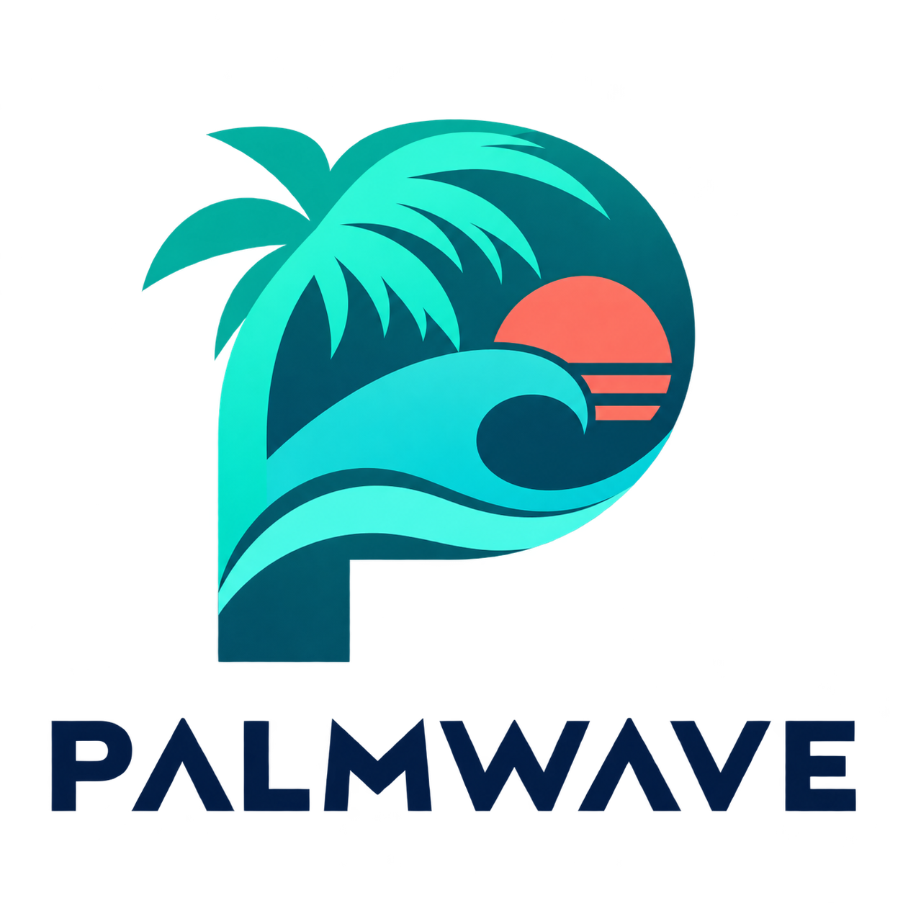

<p align="center">
  
</p>

<h1 align="center">Palmwave</h1>
<p align="center"><strong>From console code to a PC frame.</strong></p>
<p align="center">Xbox Series X|S compatibility for Windows x64 · Direct3D 12 · RDNA2 → HLSL → DXIL</p>
<p align="center">
  <a href="https://realmoon.ai">Moon AI</a> ·
  <a href="#compatibility">Compatibility</a> ·
  <a href="#build-and-run">Build and run</a> ·
  <a href="https://github.com/fablinoo/palmwave/issues">Issues</a>
</p>

Palmwave is an Xbox Series X|S compatibility project from **Moon AI**, the AI platform created by **Stellarr Studio**. This edition is based on XCL. It runs a title’s x64 code natively on Windows, implements the console APIs that code calls, and translates RDNA2 shaders through HLSL and DXIL for Direct3D 12. The launcher, Cargo package and configuration variables use their upstream XCL names. [XCL source at the revision used here](https://github.com/ivall/xcl/tree/db1ddb25f3ff0c1686eed8200d238ad35f895926)

## Compatibility

At the pinned revision, XCL reports playable worlds in **Minecraft Preview** and playable **Unicorn Overlord**. For another Xbox Series executable, its maintainers report reaching the settings menu. Gameplay beyond those menus remains unverified. This migration did not include a Palmwave game run on the RTX 5080. [Upstream compatibility table](https://github.com/ivall/xcl/blob/db1ddb25f3ff0c1686eed8200d238ad35f895926/README.md#games)

On a GPU with 32-lane waves, including the RTX 5080, the recompiler implements wave64 compute and mesh operations with two cooperating halves. Vertex and pixel shaders that read lanes 32–63 still have accuracy limits. [Wave64 implementation notes](docs/wave64-on-wave32.md)

## Build and run

Use Windows 10/11 x64, stable Rust with the MSVC toolchain, Visual Studio C++ build tools, the Windows SDK with DXC, and Windows Gaming Services. The graphics path targets Direct3D 12, Shader Model 6.6 and mesh shaders. Windows 10 may also require the D3D12 Agility SDK. [DXC and Agility SDK setup](https://github.com/ivall/xcl/blob/db1ddb25f3ff0c1686eed8200d238ad35f895926/README.md#building-and-usage)

```powershell
git clone https://github.com/fablinoo/palmwave.git
cd palmwave
cargo build --release --locked --workspace
.\target\release\xcl.exe --version
```

To inspect an executable or launch your own unpacked title in offline mode, replace the example paths with your local paths. Opening `xcl.exe` from Explorer also brings up the title picker.

```powershell
$env:XCL_NETWORK = "0"
.\target\release\xcl.exe inspect "D:\Xbox\Title\title.exe"
.\target\release\xcl.exe run "D:\Xbox\Title"
```

The runtime directs title writes to an overlay. Each run records GPU activity, unsupported calls and crash information in `%LOCALAPPDATA%\XCL\<title>\logs\report.json`. For a rendering report, include the GPU, driver, commit and what appeared on screen. A present count alone cannot tell a black frame from a menu.

## Development

Run the workspace tests with `.\scripts\test.ps1`. The script reports GPU tests skipped on the selected adapter. The repository includes a synthetic title for end-to-end checks. [Test title](tests/testtitle) · [Contributor guide](CONTRIBUTING.md) · [Runtime design](docs/specs/2026-11-20-xcl-design.md)

## License and credits

The runtime comes from **ivall/xcl** and its contributors and is distributed under **GPL-2.0-only**. Third-party notices accompany the source. The Palmwave logo retains the license under which it was previously published. [Runtime license](LICENSE) · [Third-party notices](THIRD_PARTY.md) · [Logo license](assets/LICENSE.palmwave-logo)

**AI used:** [realmoon.ai](https://realmoon.ai) (Moon AI)
